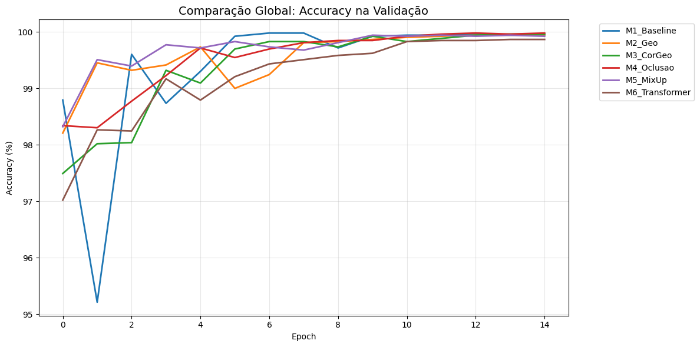
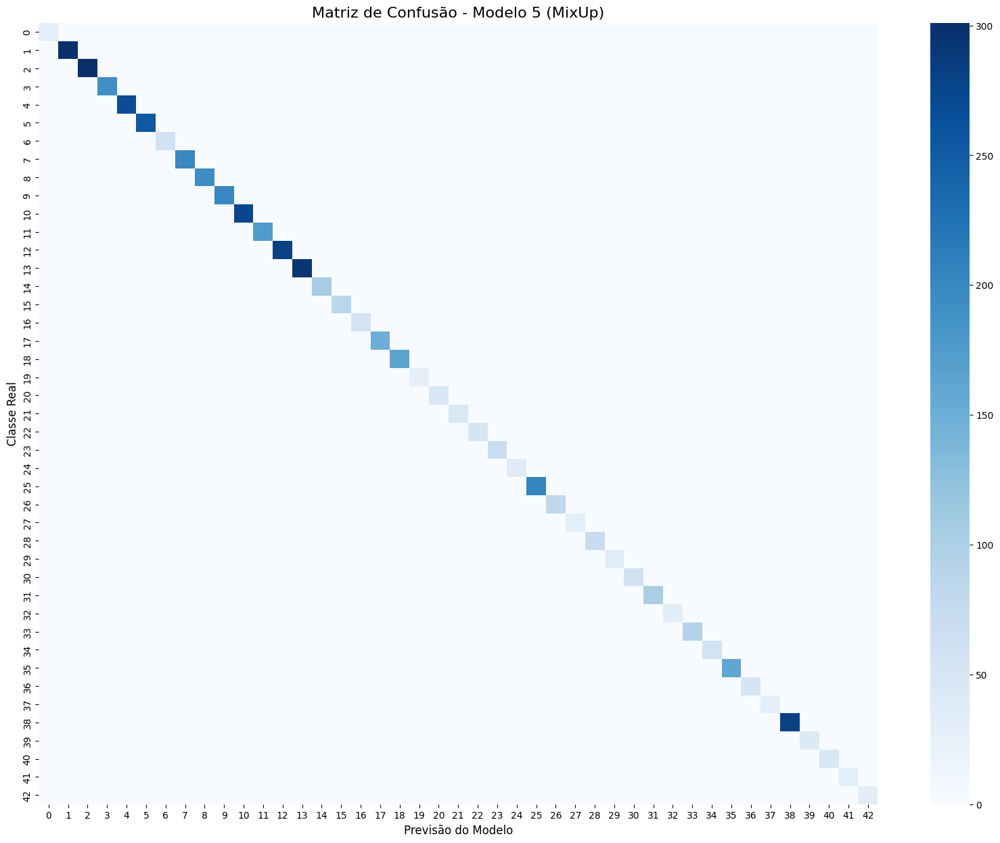
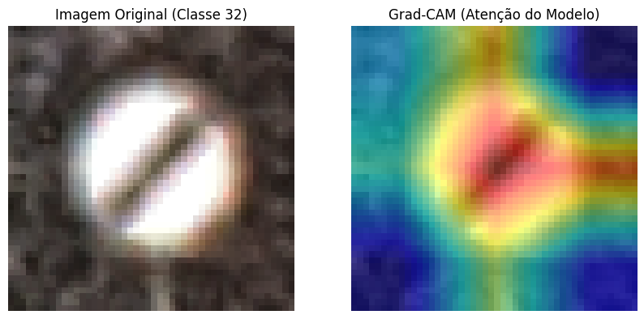
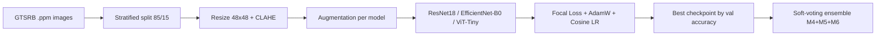
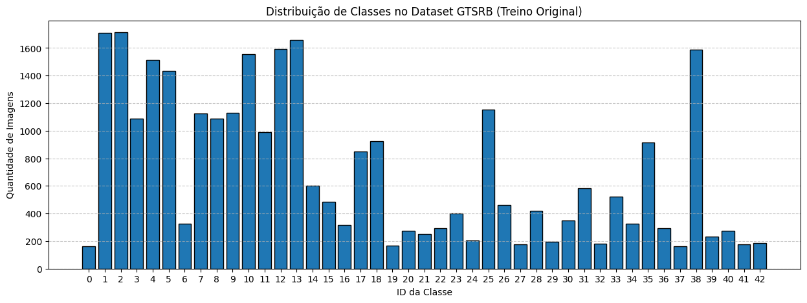
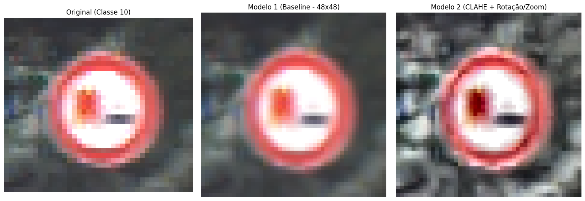

# Traffic Sign Recognition on GTSRB


Course project for *Computer Vision and Image Processing* (Master's in Informatics Engineering, University of Minho, 2025/2026): I trained and compared **six deep-learning models** on the 43 classes of the German Traffic Sign Recognition Benchmark (GTSRB), each with a different augmentation strategy, and combined three of them in a soft-voting ensemble.

- **Result:** 99.87% to 99.98% validation accuracy for the single models; the ensemble reaches **99.98%**, and M5, the model I analysed in detail, makes only **3 errors in 5,303** images.
- **What I did:** adapted ImageNet-pretrained ResNet18, EfficientNet-B0 and ViT-Tiny to 48×48 images, built the preprocessing and augmentation pipelines (CLAHE, geometric, colour, cutout, RandAugment-style, MixUp), trained with Focal Loss, and analysed the results with a confusion matrix and Grad-CAM.
- **What I learned:** validation saturates on GTSRB and a random split leaks near-identical frames, so the honest conclusion is about methodology as much as accuracy (see [Lessons and decisions](#lessons-and-decisions)).



## Table of contents

- [What this project demonstrates](#what-this-project-demonstrates)
- [Lessons and decisions](#lessons-and-decisions)
- [Results](#results)
- [Pipeline and experiments](#pipeline-and-experiments)
- [Repository structure](#repository-structure)
- [Running the code](#running-the-code)
- [References](#references)
- [License and author](#license-and-author)

## What this project demonstrates

| Area | In this project |
|------|-----------------|
| Deep learning with PyTorch | Training loops, AdamW with cosine schedule, custom Focal Loss, MixUp |
| Transfer learning | Pretrained ResNet18, EfficientNet-B0 (torchvision) and ViT-Tiny (timm) with new 43-class heads |
| Architecture adaptation | Stem changes so 224×224 networks work on 48×48 images |
| Image processing and augmentation | CLAHE, Albumentations pipelines for geometry, colour, noise and occlusion |
| Evaluation and explainability | Stratified split, confusion matrix, Grad-CAM, soft-voting ensemble |
| Critical analysis | Documented data leakage, optimistic checkpoint selection and ignored library arguments |

## Lessons and decisions

- **Small images need a different stem.** ResNet18 and EfficientNet-B0 shrink the input fast, which is too aggressive for 48×48. I changed the first convolution to 3×3 with stride 1 and removed ResNet's max-pool so the signs keep their detail.
- **CLAHE must also be applied at validation time.** In early tests I hit a domain shift: training with CLAHE-filtered images but validating on unfiltered ones. I fixed it by keeping the filter active in both (`get_valid_transform_clahe`), which is why M2 to M6 use a different validation transform from M1.
- **Class imbalance:** the largest classes have over 1,500 images and the smallest about 200, so I used Focal Loss (γ = 2) instead of plain cross-entropy.
- **More augmentation did not mean a higher score.** The baseline without augmentation (M1) reached 99.98%, as high as the best model. What augmentation changed was behaviour: M1 was unstable early (a drop to 95.2% at epoch 2) and its training accuracy hit 100%, while the ViT had the smoothest curve. Validation is saturated, so the differences are a few images.
- **The validation split is too easy.** GTSRB training images come in tracks of about 30 frames of the same physical sign, so a random split puts near-identical frames in both sets. The scores are therefore optimistic, and I report them as such. Evaluating on the official `Final_Test` set, which is downloaded but unused, is the obvious next step.
- **A silent library change affected the experiments.** With Albumentations 2.0.8, some arguments of `CoarseDropout`, `GaussNoise` and `ElasticTransform` are ignored (the warnings are in `03_models.ipynb`), so those transforms ran with library defaults. I noticed this after training. It taught me to read the warnings and pin versions; fixing it and retraining is a follow-up.

## Results

**Main result:** all six models exceed 99.8% validation accuracy, and the soft-voting ensemble (99.98%) gives no gain over the best single model (M4).

| Model | Best val. accuracy | Notes |
|-------|-------------------|-------|
| M1 Baseline | 99.98% | Unstable early on (drop to 95.2% at epoch 2), train acc. reaches 100% |
| M2 Geo | 99.94% | Not better than the baseline |
| M3 Colour + Geo | 99.96% | No notable difference vs M2 |
| M4 Occlusion | **99.98%** | Ties M1 as best single model; part of the ensemble |
| M5 RandAug + MixUp | 99.94% | Train acc. only ~94% (measured on mixed images) but near-perfect validation (final epoch: 99.92%) |
| M6 ViT-Tiny | 99.87% | Smoothest learning curve |
| **Ensemble (M4 + M5 + M6)** | **99.98%** | Same as the best single model (M4): no gain from combining |

All numbers are on the 5,303-image validation split (`05_ensemble.ipynb`, `03_models.ipynb`). I chose M5 for the detailed analysis below because MixUp acts as a strong regulariser: its training accuracy stays around 94%, the lowest of the six (it is measured on blended images, so it is not directly comparable), yet its validation accuracy is near-perfect. The ensemble uses soft voting, averaging the softmax outputs of M4, M5 and M6. The validation set saturates: the differences between models are a few images, which is probably within run-to-run noise (each model was trained once, with a single seed).



### Qualitative results

Grad-CAM on M5 (EfficientNet-B0 + MixUp) for class 32, *end of all restrictions*: the model's attention falls on the diagonal stripe in the centre of the sign and largely ignores the background.



### Limitations

- **No test-set evaluation:** all numbers come from a validation split of the training images, which likely inflates them because of near-identical frames in both sets (see [Lessons and decisions](#lessons-and-decisions)).
- **Checkpoint selection on the same split that is reported**, so "best val. accuracy" is optimistic.
- **Ignored augmentation arguments:** M3 to M6 did not use the exact intended transform parameters (caveat in [Pipeline and experiments](#pipeline-and-experiments)).

## Pipeline and experiments

Each image is resized to 48×48 and, for most models, its contrast is equalised with **CLAHE** (Contrast Limited Adaptive Histogram Equalisation), which evens out dark and over-exposed signs. During training, random transformations (rotation, zoom, colour changes, noise, black patches) create new variations of each image so the network learns the sign and not the photo. A pretrained CNN or Transformer then predicts one of the 43 classes. Finally, the probabilities of three different models are averaged (soft voting).



The six experiments, from simplest to most regularised:

| Model | Architecture | Training augmentation | What it tests |
|-------|--------------|-----------------------|---------------|
| M1 Baseline | ResNet18 (modified) | None, only resize + normalisation | Reference point |
| M2 Geo | ResNet18 (modified) | CLAHE + shift/scale/rotate (±10%, ±20%, ±15°) | Camera angle and distance |
| M3 Colour + Geo | ResNet18 (modified) | M2 + brightness/contrast, hue/saturation, Gaussian noise | Weather and colour degradation |
| M4 Occlusion | EfficientNet-B0 (modified) | M2 + CoarseDropout (cutout) | Signs partly hidden by branches or stickers |
| M5 RandAug + MixUp | EfficientNet-B0 (modified) | CLAHE + 2 random heavy transforms (applied with 80% probability) + MixUp (α=0.2) | Strong regularisation against memorisation |
| M6 Transformer | ViT-Tiny (timm, `img_size=48`) | Same as M3 | Self-attention instead of convolutions |

> **Caveat:** with Albumentations 2.0.8, some arguments of `CoarseDropout` (`max_holes`, `max_height`, ...), `GaussNoise` (`var_limit`) and `ElasticTransform` (`alpha_affine`) are ignored (warnings in `03_models.ipynb`). The noise in M3 and M6, the cutout in M4 and the cutout and elastic transforms in M5 therefore ran with the library defaults, not the values listed here. The experiments compare augmentation *families*, not the exact parameters above.

Checkpoints are saved to `checkpoints/` with the Portuguese names used in the code:

| Model | Checkpoint file |
|-------|-----------------|
| M1 | `modelo1_baseline_resnet18.pth` |
| M2 | `modelo2_geo_resnet18.pth` |
| M3 | `modelo3_cor_geo_resnet18.pth` |
| M4 | `modelo4_oclusao_efficientnet.pth` |
| M5 | `modelo5_mixup_efficientnet.pth` |
| M6 | `modelo6_cct_transformer.pth` |

M6 is a ViT-Tiny. The `cct` in the file name and in `get_cct_model()` (`src/models.py`) is a leftover from an earlier plan to use a Compact Convolutional Transformer.

Validation always uses only resize + normalisation (M1) or resize + CLAHE + normalisation (M2–M6), never random augmentation.

### Data

- **Dataset:** [GTSRB](https://benchmark.ini.rub.de/gtsrb_dataset.html), training set in `data/GTSRB/Training/<class_id>/` (`.ppm` images, 43 classes).
- **Split:** stratified 85% / 15% with `random_state=42`, giving **30,044 training** and **5,303 validation** images.
- **Imbalance:** the largest classes have more than 1,500 images and the smallest about 200, which is why Focal Loss is used.
- **Normalisation:** GTSRB mean `[0.3403, 0.3121, 0.3214]`, std `[0.2724, 0.2608, 0.2669]`.
- The `Final_Test` folder is present in `data/GTSRB/` but is not used by any notebook.





### Models and training

- **Small-image adaptation:** ResNet18 and EfficientNet-B0 were designed for 224×224 ImageNet images and shrink the input quickly. The first convolution was changed to a 3×3 kernel with stride 1 and ResNet's initial max-pool was removed, so 48×48 images keep their spatial detail.
- **Sizes:** ResNet18 ≈ 11.2 M parameters, EfficientNet-B0 ≈ 4.1 M, ViT-Tiny ≈ 5.5 M (all ImageNet-pretrained, new 43-class head).
- **Loss:** Focal Loss (γ = 2) to focus on hard, under-represented examples.
- **Optimiser:** AdamW (lr 1e-3 for the CNNs, 1e-4 for the ViT, weight decay 1e-4) with a Cosine Annealing scheduler.
- **Training:** 15 epochs, batch size 64, on a CUDA GPU. The checkpoint with the best validation accuracy is saved to `checkpoints/`.

## Repository structure

```
.
├── notebooks/
│   ├── 01_EDA.ipynb            # split + class distribution
│   ├── 02_preprocessing.ipynb  # visual check of CLAHE and augmentation
│   ├── 03_models.ipynb         # trains the six models (M1-M6) and plots curves
│   ├── 04_analysis.ipynb       # confusion matrix and Grad-CAM for M5
│   └── 05_ensemble.ipynb       # soft-voting ensemble of M4, M5 and M6
├── src/
│   ├── dataset.py              # stratified split, GTSRBDataset, dataloaders
│   ├── augmentation.py         # Albumentations pipelines for each model
│   ├── models.py               # modified ResNet18, EfficientNet-B0, ViT-Tiny
│   ├── losses.py               # Focal Loss
│   └── train.py                # train/validate loops, MixUp
├── checkpoints/                # best weights per model (*.pth, git-ignored, created by 03_models)
├── data/GTSRB/                 # Training/ and Final_Test/ (git-ignored)
├── docs/images/                # figures used in this README
└── requirements.txt            # dependencies
```

`venv/`, `data/`, `checkpoints/` and `*.pth` are git-ignored. Code comments and docstrings are in English; the notebooks and the checkpoint file names are still in Portuguese.

## Running the code

This is a portfolio project, but everything is reproducible. **Prerequisites:** Python 3.12, a CUDA GPU (strongly recommended) and the GTSRB training images, downloaded from the [dataset page](https://benchmark.ini.rub.de/gtsrb_dataset.html) and placed in `data/GTSRB/Training/00000 … 00042/` (`.ppm` files). Internet access is needed on the first run to download the ImageNet weights.

```bash
python -m venv venv
source venv/bin/activate
pip install -r requirements.txt
cd notebooks
jupyter notebook
```

Run the notebooks **from the `notebooks/` folder** (paths such as `../data` and `../checkpoints` are relative to it), in this order:

1. `01_EDA` and `02_preprocessing`: quick, no training.
2. `03_models`: trains all six models one after the other (15 epochs each). This is the long step.
3. `04_analysis` and `05_ensemble`: load the saved checkpoints, so they need step 2 first.

The checkpoints are git-ignored, so a fresh clone has none: you must run `03_models` once to create them. `NUM_EPOCHS` is set in the setup cell of `03_models.ipynb`; the batch size and learning rate are set in each model's cell. `requirements.txt` pins the versions of the original virtual environment.

## References

- J. Stallkamp, M. Schlipsing, J. Salmen, C. Igel. *Man vs. computer: Benchmarking machine learning algorithms for traffic sign recognition.* Neural Networks, 2012. [GTSRB](https://benchmark.ini.rub.de/gtsrb_dataset.html)
- K. He et al. *Deep Residual Learning for Image Recognition.* CVPR 2016. [arXiv:1512.03385](https://arxiv.org/abs/1512.03385)
- M. Tan, Q. Le. *EfficientNet: Rethinking Model Scaling for CNNs.* ICML 2019. [arXiv:1905.11946](https://arxiv.org/abs/1905.11946)
- A. Dosovitskiy et al. *An Image is Worth 16x16 Words: Transformers for Image Recognition at Scale.* ICLR 2021. [arXiv:2010.11929](https://arxiv.org/abs/2010.11929)
- T.-Y. Lin et al. *Focal Loss for Dense Object Detection.* ICCV 2017. [arXiv:1708.02002](https://arxiv.org/abs/1708.02002)
- H. Zhang et al. *mixup: Beyond Empirical Risk Minimization.* ICLR 2018. [arXiv:1710.09412](https://arxiv.org/abs/1710.09412)
- R. R. Selvaraju et al. *Grad-CAM: Visual Explanations from Deep Networks.* ICCV 2017. [arXiv:1610.02391](https://arxiv.org/abs/1610.02391)
- K. Zuiderveld. *Contrast Limited Adaptive Histogram Equalization.* Graphics Gems IV, 1994.

## License and author

Copyright © 2026 Rui Rodrigues ([@RuiRodrigues08](https://github.com/RuiRodrigues08)), Master's in Informatics Engineering, University of Minho. **All rights reserved.** The code is public so it can be viewed as part of my portfolio, but no license is granted: copying, modifying or reusing it requires my written permission (see [LICENSE](LICENSE)). GTSRB has its own terms of use (see the dataset page); the pretrained ImageNet weights come from torchvision and timm under their respective licenses.
